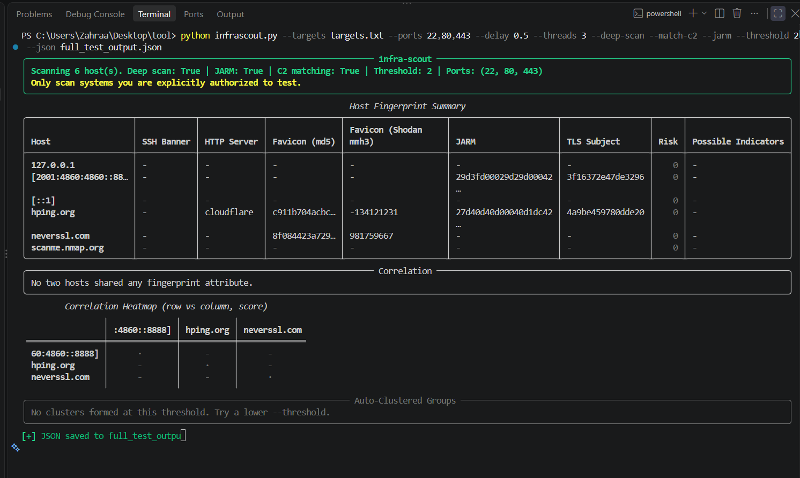
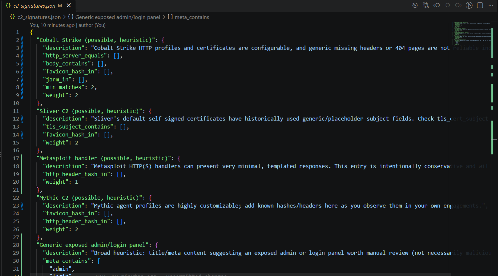

# InfraScout

A modular Python tool built for **Threat Intelligence Analysts**, **Incident Responders**, and **Threat Hunters**. **InfraScout** collects active fingerprints from target hosts—including SSH banners, HTTP/HTTPS headers, SSL/TLS certificate subjects, Favicon hashes (MD5 & Shodan mmh3), and **active JARM signatures**—to correlate infrastructure and detect C2 (Command and Control) frameworks beyond volatile IP addresses.

## 📸 Demo & Execution Output

Here is a preview of InfraScout executing a deep scan across multi-protocol targets:


*Execution showing Host Fingerprint Summary, SSH Banners, JARM, Favicon Hashes, and Correlation Heatmaps.*


*Correlation matrix, Auto-Clustering evaluation, and structured JSON output generation.*

## 🌟 Key Features

* **Multi-Protocol Fingerprinting:**
  * **SSH:** Captures SSH host banners and versions.
  * **HTTP/HTTPS:** Identifies server software, hashes HTTP headers, extracts page titles, and parses HTML meta signatures.
  * **Favicon Analysis:** Computes standard `MD5` and Shodan-compatible `mmh3` hashes for web application panel tracking.

* **Active JARM Fingerprinting (`--jarm`):** Probes servers using 10 custom TLS Client Hello requests to generate deterministic JARM signatures regardless of certificate alterations.

* **Custom Port Selection (`--ports`):** Allows scanning custom or non-standard ports (e.g., `22,80,443,8080,8443`) to find hidden services.

* **IPv6 & Domain Support:** Seamless handling for domain names, IPv4, and IPv6 addresses (e.g., `[::1]`, `[2001:4860:4860::8888]`).

* **Rate Limiting & Stability (`--delay`):** Configurable delay intervals between requests to avoid triggering WAF blocks or rate-limiting bans.

* **Heuristic C2 Signature Matching (`--match-c2`):** Matches retrieved fingerprints against known threat signatures (e.g., Cobalt Strike, Sliver) with customizable match thresholds (`--threshold`).

* **Infrastructure Correlation & Auto-Clustering:** Generates a pairwise similarity matrix (Correlation Heatmap) and clusters related host infrastructures.

* **Automation Ready (`--quiet` / `--no-rich`):** Disable terminal formatting to pipe clean JSON structured data directly into automation scripts or CI/CD pipelines.

## ⚙️ Installation

1. **Clone the Repository:**
   ```bash
   git clone https://github.com/your-username/InfraScout.git
   cd InfraScout
   ```

2. **Install Dependencies:**
   ```bash
   pip install -r requirements.txt
   ```
   *(Dependencies include `requests`, `pyjarm`, `rich`, and `mmh3`)*

## 📂 Target Configuration (`targets.txt`)

Create a `targets.txt` file containing your target domains, IPv4, or IPv6 addresses (one per line). Comments starting with `#` are ignored:

```text
# Localhost and IPv6 testing targets
127.0.0.1
[2001:4860:4860::8888]
[::1]

# Public Domain Targets
hping.org
neverssl.com
scanme.nmap.org
```

## 🚀 Execution & Usage

Run a full deep-scan with JARM fingerprinting, C2 matching, rate limiting, and output to JSON:

```bash
python infrascout.py --targets targets.txt --ports 22,80,443 --delay 0.5 --threads 3 --deep-scan --match-c2 --jarm --threshold 2 --json full_test_output.json
```

### Command Flags Breakdown

| Flag | Description |
| :--- | :--- |
| `--targets targets.txt` | Path to the text file containing domains and IP addresses. |
| `--ports 22,80,443` | Specifies custom ports to inspect across targets. |
| `--delay 0.5` | Sets a `0.5` second delay between probes for rate limiting. |
| `--threads 3` | Number of concurrent worker threads. |
| `--deep-scan` | Enables extended HTTP content parsing and header hashing. |
| `--match-c2` | Runs C2 threat signature matching algorithms. |
| `--jarm` | Initiates active JARM TLS stack fingerprinting probes. |
| `--threshold 2` | Minimum indicator threshold for correlation clustering. |
| `--json full_test_output.json` | Saves structured output to a JSON file. |

## 📄 Output Schema Example (`full_test_output.json`)

```json
[
  {
    "host": "scanme.nmap.org",
    "ports": [22, 80, 443],
    "ssh_banner": "SSH-2.0-OpenSSH_6.6.1p1 Ubuntu-2ubuntu2.13",
    "http_server": null,
    "favicon_md5": null,
    "favicon_mmh3": null,
    "jarm": null,
    "tls_subject": null,
    "risk": 0,
    "possible_indicators": []
  },
  {
    "host": "hping.org",
    "ports": [22, 80, 443],
    "ssh_banner": null,
    "http_server": "Cloudflare",
    "favicon_md5": "c911b704acbc...",
    "favicon_mmh3": "-134121231",
    "jarm": "27d40d40d00040d1dc42...",
    "tls_subject": "4a9be459780dde20",
    "risk": 0,
    "possible_indicators": []
  }
]
```

## 🤝 Contributing

Pull requests, signature contributions, and feature suggestions are welcome! Feel free to open an issue or submit a PR.

## 📜 License

This project is licensed under the MIT License.
